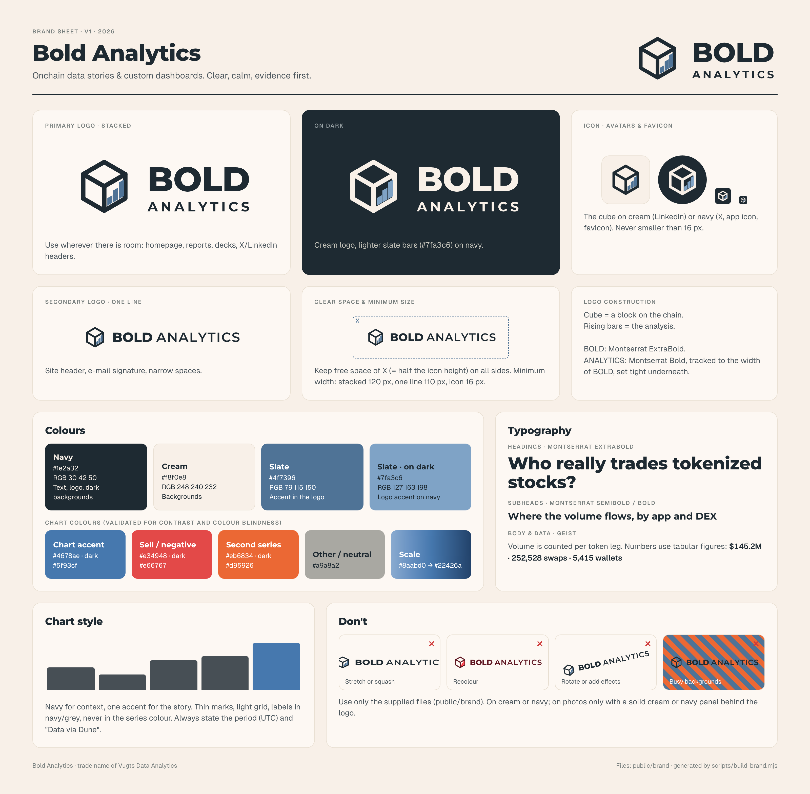

# Bold Analytics brand



- **Brand sheet:** [`brand-sheet.png`](brand-sheet.png) · [`brand-sheet.pdf`](brand-sheet.pdf) (source: `brand-sheet.html`)
- **Logo files:** [`../public/brand/`](../public/brand) (also served on the site at `/brand/...`)

| File | Use |
|---|---|
| `logo-stacked.svg` / `logo-stacked-on-dark.svg` | Primary logo |
| `logo-horizontal.svg` / `logo-horizontal-on-dark.svg` | Header, e-mail, narrow spaces |
| `icon.svg` / `icon-on-dark.svg` | Cube only |
| `linkedin-logo-400.png` | LinkedIn company / experience logo |
| `linkedin-cover-1128x191.png` | LinkedIn company page cover |
| `linkedin-banner-1584x396.png` | LinkedIn personal profile banner (logo right, clear of the profile photo) |
| `x-avatar-400.png` · `x-header-1500x500.png` | X profile picture and header |
| `favicon.svg` · `favicon-32.png` · `mark-*.svg` | Favicon, app icons |
| `logo-stacked-2000.png` / `-on-dark-2000.png` | Large PNG for decks and documents |
| `colors.json` | Brand colours |

**Colours:** navy `#1e2a32`, cream `#f8f0e8`, slate `#4f7396` (logo accent), slate on dark `#7fa3c6`.
Charts use a slightly more saturated slate `#4678ae` (dark `#5f93cf`) so the accent reads as colour; see the sheet.

**Type:** Montserrat ExtraBold / Bold / SemiBold for the logo and headings, Geist for body text and data.

## Regenerate

```bash
node scripts/build-brand.mjs                                   # SVGs + app/icon.svg
NODE_PATH=$(npm root -g) node scripts/render-brand-png.cjs     # PNGs (Playwright)
NODE_PATH=$(npm root -g) node scripts/render-brand-sheet.cjs   # brand sheet PNG + PDF
```
